<!-- KELOMPOK 5 / 第五組 — Edo x neon-night-street README. All art lives in docs/readme (SVG + one GIF). -->
<a id="top"></a>
<div align="center">

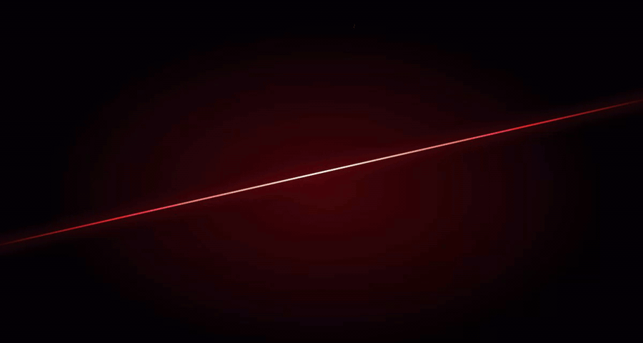

<br />

<a href="#about"></a>
<a href="#team"></a>
<a href="#work"></a>
<a href="#honours"></a>
<a href="#arsenal"></a>
<a href="#run"></a>

<br /><br />

**Four minds. One collective. Endless possibilities.**<br />
<sub>Tugas Besar Portofolio · Kelompok 5 · React 19 + Vite 8 + TypeScript + Tailwind CSS 4</sub>

</div>


<a id="about"></a>


**Kelompok 5 Portfolio** is the group portfolio website of a four-person student team. It is a single-page React app with its own tiny push-state router and presents the team, two competition case studies, the awards they won and the tools they work with.

| | |
|---|---|
| **Pages** | Home · Projects · Case studies (PHARVIA, AMANIN) · Team · four member profiles · Achievements · About / Contact |
| **Stack** | React 19, Vite 8, TypeScript 5, Tailwind CSS 4, plain CSS layers for the theme |
| **Look** | Edo ukiyo-e meets a neon-lit night street: seigaiha waves, irezumi crimson, gold fittings, lanterns and signs |
| **Content** | Lives in typed files under `src/data/`, no CMS and no backend |

> [!NOTE]
> The three extra project slots on the Projects page (NOMORI, KURASU, AOZORA) are labelled concept placeholders on the site itself. They are not finished projects and are not claimed as achievements.


<a id="team"></a>

<p align="center">
<a href="https://www.linkedin.com/in/vassell-enha-atthayya-182661323/"></a>
<a href="https://www.linkedin.com/in/evan-handoko-49670b314/"></a>
<a href="https://www.linkedin.com/in/rizksan/"></a>
</p>

<div align="center"><sub>Each member has a spirit animal: Tiger 虎, Kirin 麒麟, Serpent 蛇 and Koi 鯉. Tap a card to open that member's LinkedIn.</sub></div>

<br />

In both competition teams, **Rizky Sandi Pratama** is CEO, **Vassell Enha Atthayya** is CFO and **Evan Octavianus Haryo Handoko** is CTO.


<a id="work"></a>


<details>
<summary><b>PHARVIA: what the case study covers</b></summary>

<br />

*Turning Unused Medicines into Traceable Impact.* A digital take-back ecosystem that connects consumers, pharmacies, pharmaceutical companies and licensed waste partners so unused medicines are returned safely and traceably.

| Screen | What it does |
|---|---|
| **Pharvia Scan** | Scan a medicine, check its expiry date, get guidance on how to return it |
| **Pharvia Point** | Map of nearby collection points and drop-box capacity |
| **Smart Collect** | Return summary that lists each medicine before hand-off |
| **EcoPoint** | Points, impact summary and a reward catalogue |

Figures are quoted from the team's competition deck, which does not list primary sources. Financial values in the deck are projections. Status: proposed concept with UI mockups.

</details>


<details>
<summary><b>AMANIN: what the case study covers</b></summary>

<br />

*Think Before You Click. Verify Before You Trust.* An AI-powered digital safety platform that helps Indonesian users identify potential scams before making risky decisions, covering suspicious messages, links, QR codes and payment requests.

The product idea follows four verbs: **Receive → Share → Check → Decide.**

Statistics are cited from the team's project documents (IASC, GASA and the business plan proposal). Financial figures are projections. Status: proposed concept with UI mockups.

</details>


<a id="honours"></a>



<a id="arsenal"></a>



<details>
<summary><b>Site map</b></summary>

<br />


Routing is a small `pushState` router in `src/App.tsx`. `vercel.json` rewrites every path to `index.html`, so deep links keep working after a deploy.

</details>


<a id="run"></a>

```bash
# Node 22 (see .mise.toml)
npm install
npm run dev        # http://localhost:8443  (PORT=3000 npm run dev to change it)
```

| Command | Does |
|---|---|
| `npm run dev` | Dev server with hot reload |
| `npm run build` | Production build into `dist/` |
| `npm run preview` | Serve the production build locally |
| `npm run format` | Format with oxfmt |

<details>
<summary><b>Project layout</b></summary>

```text
.
├─ public/
│  ├─ assets/            logos, team portraits, spirit art, project screenshots, tool icons
│  └─ fonts/             self-hosted fonts (Latin + Japanese slices), no Google Fonts request
├─ src/
│  ├─ App.tsx            router, pages, team and project views
│  ├─ data/              all copy and facts: members, projects, achievements, tools
│  ├─ components/        profile, expertise, PHARVIA and AMANIN sections
│  ├─ fx/                intro, petals/embers canvas, slash cursor, heat gauge, lanterns, signs, skyline
│  ├─ kamuro.css         the Edo x neon night-street theme layer (loaded after index.css)
│  └─ index.css          base layout
├─ design/               untouched source artwork (branding, spirits)
├─ docs/readme/          the art in this README + its generator (build/)
└─ vercel.json           SPA rewrite
```

</details>

<details>
<summary><b>Easter eggs and motion notes</b></summary>

<br />

- The intro plays once per browser tab (`sessionStorage` key `k5-intro-seen`).
- Click anywhere for a blade slash and a petal burst. The cursor leaves a slash trail on devices with a mouse.
- Enter the Konami code (↑ ↑ ↓ ↓ ← → ← → B A) for a dragon fly-by and a maxed-out heat gauge.
- The theme is intentionally heavy: blend modes, filters, canvas particles. Users with `prefers-reduced-motion` get the calm version.

</details>

<details>
<summary><b>Regenerate the README art</b></summary>

<br />

Every graphic in `docs/readme/` is generated. Text is converted to outlines, so it looks the same on any device.

```bash
pip install fonttools brotli pillow
python docs/readme/build/build_assets.py
```

**Edo SZ:** drop `edosz.ttf` into `public/fonts/` (or set `EDO_TTF=/path/to/edosz.ttf`) and re-run. All titles switch to it. Without the file they use Bebas Neue. On the site itself, the same file in `public/fonts/` is picked up automatically for large headings.

`hero.gif` is a recording of the running site (`npm run build && npm run preview`, then `python docs/readme/build/record_hero.py http://localhost:8443`).

</details>

<details>
<summary><b>Credits and licences</b></summary>

<br />

- Team portraits, spirit illustrations, branding, competition photos and certificates belong to the team and are used for this portfolio.
- Tool logos are trademarks of their owners and appear only to identify software the team uses. Sources and licences: `public/assets/tools/ATTRIBUTION.md`.
- Fonts: Bebas Neue, Cormorant Garamond, Manrope, Permanent Marker, Yuji Boku, Dela Gothic One and Shippori Mincho are open-licensed (SIL OFL / Apache 2.0) and self-hosted. Edo SZ is freeware by Vic Fieger.
- The night-street styling is original work. It does not use characters, logos or assets from any game.

</details>


<div align="center"><a href="#top">▲ back to the top</a></div>
